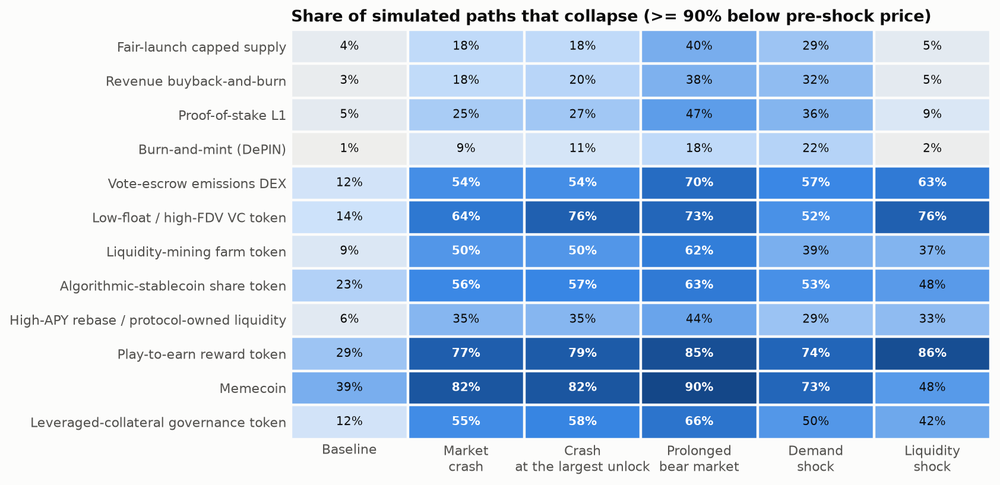

# Tokenomics Stress Lab

Independent simulations of token supply, unlocks and incentives under shocks.

A Python simulator for token economies, calibrated on real unlock data and used to stress-test
12 token designs. Full write-up: [REPORT.md](REPORT.md).

## Results

- **Backtest of 60 real unlock events.** Insider/investor cliff unlocks across 33 tokens
  (2022-2026, $14.2bn unlocked). From 30 days before to 30 days after the unlock, tokens
  returned -16.5% on average relative to the market (median -18.3%, t = -4.11); 77% of events
  were negative. Larger unlocks relative to circulating supply did worse (slope t = -3.06).
- **Stress test of 12 token designs.** 6 scenarios, 4,000 Monte Carlo paths each.
  **7 of 12 designs collapsed in crashes** (fell 90%+ below their pre-crash price in most paths
  in at least one of three crash scenarios): low-float/high-FDV, vote-escrow DEX, liquidity
  farm, algorithmic-stablecoin share token, play-to-earn, memecoin, leveraged-collateral
  governance. Survivors: fair-launch, revenue buyback-and-burn, proof-of-stake L1,
  burn-and-mint, high-APY rebase.
- **How firm is the 7.** Six collapse in all three crash scenarios. The seventh, the liquidity
  farm, collapses only in the prolonged bear and at 50.4% of paths, which is a coin-flip. The
  count also moves with the crash size: 3 designs collapse in a 50% crash, 8 in a 70% crash.
- **A 13th design.** A reserve-backed rework of the algorithmic-stablecoin token brings its
  worst-case collapse probability from 61% to 43%. The bigger change is one the 90% test hides:
  the original ends near zero in 44% of bear-market paths and its supply grows more than 10x in
  89% of them (63% even with no shock); the rework does neither.



## Layout

| Module | What it does |
|---|---|
| `tokenlab/backtest/data.py` | Builds the unlock sample: DefiLlama vesting schedules and prices, CoinMarketCap circulating supply |
| `tokenlab/backtest/study.py` | Event study: abnormal returns vs BTC over days -30..+30 |
| `tokenlab/calibrate.py` | Fits market depth so replayed unlocks match the observed price impact |
| `tokenlab/model.py` | The simulator |
| `tokenlab/designs.py` | The 12 designs and the 13th |
| `tokenlab/shocks.py` | The 6 scenarios |
| `tokenlab/stress.py` | Design x scenario runs, verdicts, sensitivity |
| `tokenlab/report.py` | Figures and `REPORT.md` |

## Run

```bash
pip install -r requirements.txt
python -m tokenlab all     # backtest, calibrate, stress, report (~20 min, offline)
python -m tokenlab data    # rebuild the unlock sample from the APIs
python -m pytest
```

The unlock sample is committed in `data/`, and seeds are fixed, so `all` reproduces the report.

Testing your own design:

```python
from tokenlab.model import Allocation, TokenDesign, simulate
from tokenlab.shocks import BY_KEY as SCENARIOS

design = TokenDesign(
    key="mine", name="My token", description="",
    allocations=[
        Allocation("Public", 0.40, "public", tge=1.0),
        Allocation("Investors", 0.25, "investor", cliff_days=365, cliff_frac=0.25, vest_days=730),
        Allocation("Team", 0.20, "team", cliff_days=365, cliff_frac=0.25, vest_days=730),
        Allocation("Treasury", 0.15, "treasury", vest_days=1460),
    ],
    revenue_yield=0.05, buyback_share=0.5,
)
res = simulate(design, SCENARIOS["crash"], paths=2000, seed=1)
print("P(collapse):", (res.max_drawdown() >= 0.9).mean())
```

## Caveats

The designs are archetypes with round-number parameters, not models of specific tokens. Only
market depth is fitted to data; beta, reflexivity and the other behavioural constants are
assumptions, and the report shows the verdicts are sensitive to them. Not investment advice.

## License

MIT
