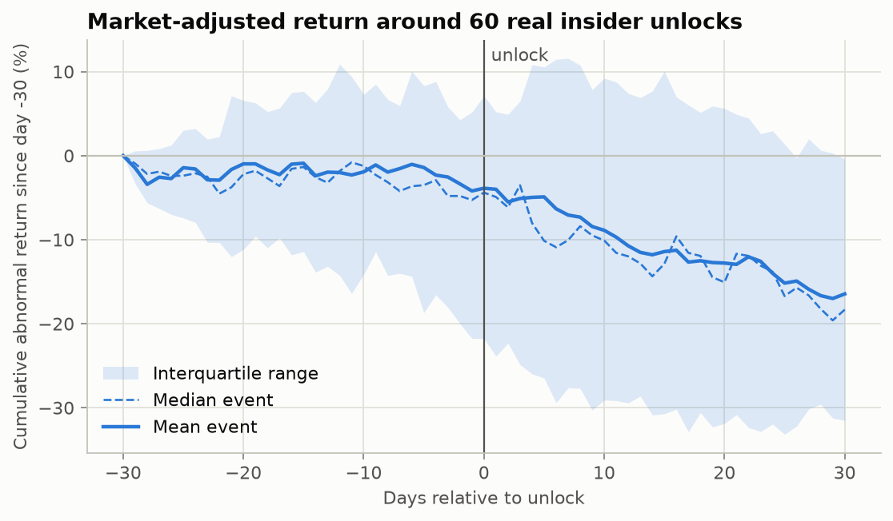
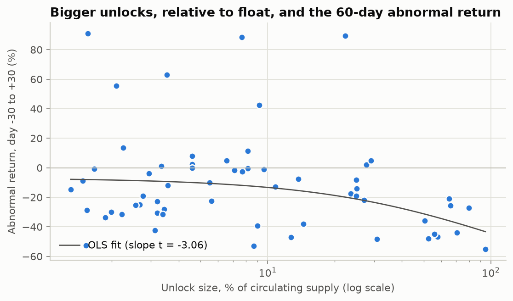
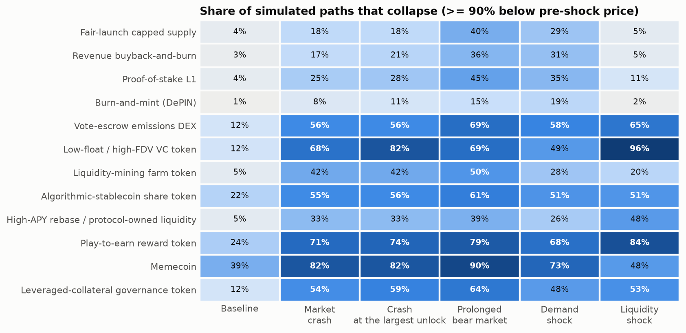
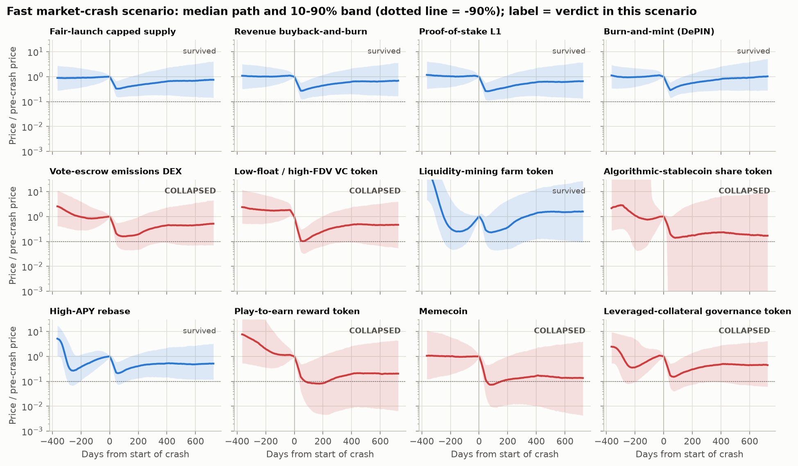
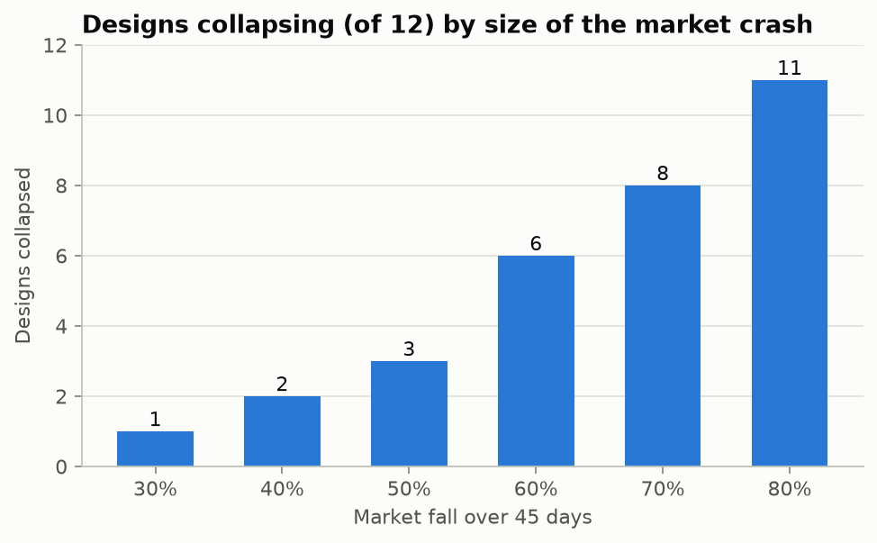

# Tokenomics Stress Lab

Independent simulations of token supply, unlocks and incentives under shocks.

## Summary

- **Backtest.** 60 real insider/investor cliff unlocks across 33 tokens (2022-01-01 to 2026-09-25, $14.2bn unlocked). From 30 days before to 30 days after the unlock, tokens returned -16.5% on average relative to the market (median -18.3%, t = -4.11); 77% of events were negative.
- **Stress test.** 12 token designs, 6 scenarios, 4,000 Monte Carlo paths each. **7 of 12 designs collapsed in crashes**: they fell at least 90% below their pre-crash price in most paths in at least one of the three market-crash scenarios (market crash: 6; crash at the largest unlock: 6; prolonged bear market: 7). Collapsed: Algorithmic-stablecoin share token, Leveraged-collateral governance token, Liquidity-mining farm token, Low-float / high-FDV VC token, Memecoin, Play-to-earn reward token, Vote-escrow emissions DEX. Survived: Burn-and-mint (DePIN), Fair-launch capped supply, Proof-of-stake L1, High-APY rebase / protocol-owned liquidity, Revenue buyback-and-burn.
- **Close calls.** These verdicts are within 5 points of the 50% line and are coin-flips: Proof-of-stake L1 in prolonged bear market (45.1%); Liquidity-mining farm token in prolonged bear market (50.4%); Leveraged-collateral governance token in market crash (54.1%).
- **The count depends on the crash size.** 3 designs collapse in a 50% crash, 6 at 60% and 8 at 70% (fast crash only).
- **A 13th design.** Reworking the algorithmic-stablecoin token so the stablecoin is reserve-backed takes its worst crash-scenario collapse probability from 61% to 43%, below the 50% line (section 4).

## 1. Backtest: real unlock events

**Data.** Vesting schedules and cliff events are from DefiLlama's open emissions datasets, daily prices from the DefiLlama coins API, and circulating supply from CoinMarketCap's historical quotes (market cap divided by price, last quote before the unlock). An event is kept only if the two price sources agree within 15%. Selection: cliff unlocks to team/advisors or private investors, between 1% and 100% of circulating supply, full daily prices from day -120 to +30, same-token events at least 61 days apart, at most 3 per token, then the 60 largest by USD value. The median event unlocked 7.4% of circulating supply. Tokens with no CoinMarketCap supply history are left out. The list is in the appendix and in `data/unlock_events.csv`.

**Method.** Daily log returns are adjusted with a market model against BTC (beta from days -120 to -31). Averages are means of cumulative log abnormal returns, converted to percent; t-statistics are cross-sectional. The arithmetic mean of simple returns over the full window is -11.3%; it differs because a few events had very large gains.

| Window | Mean | Median | t-stat | Share negative | Sign-test p |
|---|---|---|---|---|---|
| Day -30 to 0 | -3.9% | -4.4% | -0.80 | 60% | 0.155 |
| Day -7 to 0 | -2.4% | -5.0% | -1.09 | 65% | 0.027 |
| Day 0 to +7 | -3.3% | -2.2% | -2.07 | 63% | 0.052 |
| Day 0 to +30 | -13.1% | -13.7% | -3.73 | 75% | 0.000 |
| Day -30 to +30 | -16.5% | -18.3% | -4.11 | 77% | 0.000 |

Without the beta adjustment the full-window mean is -16.1% raw and -16.8% relative to BTC (t = -4.33).

**Size.** Regressing the full-window return on ln(1 + unlock / circulating supply) gives a slope of -0.74 (t = -3.06, R2 = 0.14).

| Unlock size (% of circulating) | Events | Mean | Median | Share negative |
|---|---|---|---|---|
| 1.3% - 3.4% | 20 | -16.7% | -23.9% | 80% |
| 3.4% - 12.8% | 20 | -5.7% | -1.4% | 65% |
| 13.7% - 94.5% | 20 | -25.8% | -23.7% | 85% |

## 2. The simulator

`tokenlab/model.py` is a daily-step Monte Carlo model. A design sets allocations and vesting, emissions, staking, revenue and value capture, liquidity, and optional reflexive mechanisms (stablecoin redemptions that mint tokens, collateral liquidation bands, USD-pegged rewards, usage that follows the token price). Each day the log price moves with the market, idiosyncratic news, reversion toward a fair value that grows with adoption and is diluted by supply, trend-following flows, buying support below cash-flow value, and net token flow divided by market depth. Depth shrinks in drawdowns.

**Calibration.** Market depth is the one parameter fitted to data. It is set to 0.27 so that replaying the 60 real unlocks (same size, same recipient type) through a plain token reproduces the observed mean return of -16.5%. At that depth, selling 1% of circulating supply moves the price about 3.7% before feedback. The other behavioural constants are assumptions, listed at the top of `model.py`.

### The 12 designs

| # | Design | Description |
|---|---|---|
| 1 | Fair-launch capped supply | No insiders, no treasury. Fully liquid float plus a halving emission to miners/validators. No cash flows; value is purely monetary premium. |
| 2 | Revenue buyback-and-burn | Fee-generating protocol that spends half of revenue buying and burning tokens and pays a further share to stakers. Standard 1y cliff / 3y vest. |
| 3 | Proof-of-stake L1 | 5% staking inflation, 60% of supply staked with a 21-day unbonding period, half of gas fees burned. Insiders on a 1y cliff / 3y vest. |
| 4 | Burn-and-mint (DePIN) | Users must buy and burn tokens to pay for a real-world service; operators are paid with a decaying emission. Usage is only weakly tied to crypto markets. |
| 5 | Vote-escrow emissions DEX | High emissions directed to liquidity pools by vote-locked holders, who receive trading fees. Locks average one year; liquidity is rented with emissions. |
| 6 | Low-float / high-FDV VC token | ~11% of supply liquid at launch; 45% held by investors and team with a one-year cliff followed by two years of vesting. Little revenue, no value capture. |
| 7 | Liquidity-mining farm token | Very high emissions paid to liquidity providers, who mostly sell. Usage and liquidity exist only while the reward is valuable. |
| 8 | Algorithmic-stablecoin share token | Token absorbs the volatility of an under-collateralised stablecoin: each $1 redeemed mints $1 of new tokens. Stablecoin supply starts at 30% of token market cap. |
| 9 | High-APY rebase / protocol-owned liquidity | Triple-digit staking APY paid in new tokens, 90% of supply staked with no unbonding delay. The protocol owns its liquidity and a treasury backing ~10% of price. |
| 10 | Play-to-earn reward token | Uncapped reward emission to players, who sell most of it. Rewards are topped up as price falls; player activity (and therefore token sinks) follows the token price. |
| 11 | Memecoin | Entire supply liquid from day one, liquidity pool half burned. No revenue, no sinks; price is attention and momentum. |
| 12 | Leveraged-collateral governance token | Half the float is staked and widely re-used as loan collateral. Price falls trigger liquidation bands and fast unstaking (7-day unbonding). |

### Scenarios

| Scenario | Description |
|---|---|
| Baseline | No shock. Flat-drift market with normal crypto volatility. |
| Market crash | Crypto market falls 60% in 45 days with doubled volatility, then recovers 40% of the (log) loss over the following year. |
| Crash at the largest unlock | The same crash, timed to start 15 days before the design's largest cliff unlock (identical to 'Market crash' for designs without cliffs). |
| Prolonged bear market | Slow crash: the market grinds down 75% over a year with no recovery. |
| Demand shock | Protocol usage falls 70% in 60 days while the wider market is unaffected. |
| Liquidity shock | Market depth falls 70% for six months alongside a 25% market dip. |

**Why 60%.** The crash is sized on market-wide drawdowns that have happened: Bitcoin fell about 50% in the week to 13 March 2020, total crypto market capitalisation roughly halved between mid-May and late July 2021, and it fell about 60% between early April and mid-June 2022. A 60% fall in 45 days is the severe end of that range. The choice matters: at 50% only 3 designs collapse.

## 3. Stress-test results

A path collapses if the token trades >= 90% below the pre-shock price in more than 50% of paths. A design's verdict is **Collapsed** if that happens in at least one of the three crash scenarios. "No recovery" also requires the price to end the three-year horizon below 25% of its pre-shock level.

| Design | Verdict | Crash | Crash at unlock | Prolonged bear | No recovery, crash | Median max drawdown, crash | Baseline |
|---|---|---|---|---|---|---|---|
| Fair-launch capped supply | Survived | 18% | 18% | 40% | 13% | 80% | 4% |
| Revenue buyback-and-burn | Survived | 17% | 21% | 36% | 11% | 82% | 3% |
| Proof-of-stake L1 | Survived | 25% | 28% | 45% | 15% | 84% | 4% |
| Burn-and-mint (DePIN) | Survived | 8% | 11% | 15% | 4% | 78% | 1% |
| Vote-escrow emissions DEX | **Collapsed** | 56% | 56% | 69% | 29% | 91% | 12% |
| Low-float / high-FDV VC token | **Collapsed** | 68% | 82% | 69% | 32% | 93% | 12% |
| Liquidity-mining farm token | **Collapsed** | 42% | 42% | 50% | 18% | 87% | 5% |
| Algorithmic-stablecoin share token | **Collapsed** | 55% | 56% | 61% | 50% | 93% | 22% |
| High-APY rebase / protocol-owned liquidity | Survived | 33% | 33% | 39% | 20% | 86% | 5% |
| Play-to-earn reward token | **Collapsed** | 71% | 74% | 79% | 51% | 97% | 24% |
| Memecoin | **Collapsed** | 82% | 82% | 90% | 58% | 98% | 39% |
| Leveraged-collateral governance token | **Collapsed** | 54% | 59% | 64% | 31% | 91% | 12% |

| Scenario | Designs collapsed | Which |
|---|---|---|
| Baseline | 0 of 12 | - |
| Market crash | 6 of 12 | Algorithmic-stablecoin share token, Leveraged-collateral governance token, Low-float / high-FDV VC token, Memecoin, Play-to-earn reward token, Vote-escrow emissions DEX |
| Crash at the largest unlock | 6 of 12 | Algorithmic-stablecoin share token, Leveraged-collateral governance token, Low-float / high-FDV VC token, Memecoin, Play-to-earn reward token, Vote-escrow emissions DEX |
| Prolonged bear market | 7 of 12 | Algorithmic-stablecoin share token, Leveraged-collateral governance token, Liquidity-mining farm token, Low-float / high-FDV VC token, Memecoin, Play-to-earn reward token, Vote-escrow emissions DEX |
| Demand shock | 4 of 12 | Algorithmic-stablecoin share token, Memecoin, Play-to-earn reward token, Vote-escrow emissions DEX |
| Liquidity shock | 5 of 12 | Algorithmic-stablecoin share token, Leveraged-collateral governance token, Low-float / high-FDV VC token, Play-to-earn reward token, Vote-escrow emissions DEX |

### Sensitivity

Fast crash scenario only, 2,000 paths per cell.

| Market fall | 30% | 40% | 50% | 60% | 70% | 80% |
|---|---|---|---|---|---|---|
| Designs collapsed | 1 | 2 | 3 | 6 | 8 | 11 |

| Collapse threshold (drawdown) | 80% | 85% | 90% | 95% |
|---|---|---|---|---|
| Designs collapsed | 10 | 8 | 6 | 2 |

| Market depth vs calibrated | x0.5 | x0.75 | x1.0 | x1.5 | x2.0 |
|---|---|---|---|---|---|
| Designs collapsed | 4 | 6 | 6 | 7 | 7 |

| Random seed | 1 | 2 | 3 | 4 | 5 |
|---|---|---|---|---|---|
| Designs collapsed | 6 | 6 | 6 | 6 | 6 |

### How much is the mechanism, how much the assumed market behaviour

Each design also carries three behavioural assumptions: market beta, reflexivity (trend-following) and how much of its usage follows the token price. The table reruns the collapsed designs in the fast crash with those three set to the values the survivors use (beta 1.2, reflexivity 0.15, no price-led usage) and everything else unchanged. With them, 7 of 7 are below the 50% line, so the verdicts rest on these assumptions at least as much as on supply mechanics.

| Design | P(collapse), as designed | P(collapse), survivor-level behaviour |
|---|---|---|
| Vote-escrow emissions DEX | 55% | 34% |
| Low-float / high-FDV VC token | 67% | 38% |
| Liquidity-mining farm token | 40% | 13% |
| Algorithmic-stablecoin share token | 54% | 46% |
| Play-to-earn reward token | 71% | 41% |
| Memecoin | 81% | 33% |
| Leveraged-collateral governance token | 53% | 28% |

## 4. A 13th design

**Reserve-backed stablecoin governance token.** The algorithmic-stablecoin design with the stablecoin fully backed by external reserves: redemptions are paid from reserves instead of minting tokens, so stablecoin demand no longer follows the token price, and 30% of fees go to stakers. It starts from the algorithmic-stablecoin share token and changes one thing at a time; beta and reflexivity are left as they were. It was built after seeing the results above and is not part of the 12.

| Step | Crash | Crash at unlock | Prolonged bear |
|---|---|---|---|
| As tested (algorithmic stablecoin) | 55% | 56% | 61% |
| Redemptions paid from reserves, no token minting | 56% | 61% | 65% |
| + stablecoin demand no longer follows the token price | 41% | 46% | 47% |
| + 30% of fees paid to stakers (final design) | 36% | 42% | 43% |

Across all scenarios the final design's collapse probability is 4% (baseline), 36% (market crash), 42% (crash at the largest unlock), 43% (prolonged bear market), 35% (demand shock), 24% (liquidity shock). It stays under 50% in every scenario. Removing the mint-on-redemption loop does little by itself, because in this model the run only starts once the token has already lost most of its value; the step that matters is making stablecoin demand independent of the token price.

## 5. Limitations

- The designs are archetypes with round-number parameters chosen by the author. The collapse count describes these designs under this model, not how many real tokens would fail.
- Only market depth is fitted to data. Beta, reflexivity, price-led usage and sell fractions are assumptions, and section 3 shows the verdicts are sensitive to them.
- Collapse is measured from the pre-shock price, so a design that has already bled before the shock has less left to lose and can look sturdier than it is.
- The count moves with the collapse threshold, crash size and seed.
- The backtest is 60 events. Unlock dates are public in advance, so abnormal returns mix anticipation with selling; t-statistics ignore clustering of events in time.
- The sample takes the largest unlocks among tokens with price and supply data, which tilts it toward larger, surviving tokens. Schedules come from one provider and circulating supply from another; either can be wrong.
- Not investment advice.

## Appendix: the unlock events

| ID | Date | Token | Recipients | % of circulating | USD value | Abnormal return -30..+30 |
|---|---|---|---|---|---|---|
| E01 | 2022-01-01 | HBAR (Hedera) | insiders+privateSale | 2.9% | $155m | -3.9% |
| E02 | 2022-01-08 | ICP (Internet Computer) | privateSale | 1.5% | $86m | -8.7% |
| E03 | 2022-01-23 | AVAX (Avalanche) | insiders | 3.4% | $504m | -28.1% |
| E04 | 2022-02-10 | METIS (Metis) | insiders+privateSale | 23.6% | $73m | -17.7% |
| E05 | 2022-04-01 | HBAR (Hedera) | privateSale | 2.7% | $124m | -25.1% |
| E06 | 2022-04-09 | ICP (Internet Computer) | privateSale | 1.3% | $51m | -14.8% |
| E07 | 2022-04-25 | AVAX (Avalanche) | insiders | 3.1% | $603m | -42.4% |
| E08 | 2022-09-15 | APE (ApeCoin) | insiders | 8.1% | $128m | -0.5% |
| E09 | 2022-10-14 | FLOW (Flow) | privateSale | 25.1% | $393m | -14.2% |
| E10 | 2023-03-17 | APE (ApeCoin) | insiders | 9.0% | $138m | -39.2% |
| E11 | 2023-06-15 | BLUR (Blur) | insiders+privateSale | 70.5% | $148m | -44.0% |
| E12 | 2023-11-11 | APT (Aptos) | insiders+privateSale | 8.1% | $152m | +11.4% |
| E13 | 2023-12-30 | OP (Optimism) | insiders+privateSale | 3.5% | $126m | +62.9% |
| E14 | 2024-01-06 | IMX (Immutable) | insiders+privateSale | 2.1% | $57m | +55.5% |
| E15 | 2024-01-09 | FLR (Flare) | insiders+privateSale | 9.2% | $50m | +42.6% |
| E16 | 2024-01-11 | APT (Aptos) | insiders+privateSale | 6.6% | $180m | +4.8% |
| E17 | 2024-02-02 | LINK (Chainlink) | insiders | 3.3% | $326m | +1.0% |
| E18 | 2024-03-07 | IMX (Immutable) | insiders+privateSale | 2.0% | $87m | -30.0% |
| E19 | 2024-03-12 | APT (Aptos) | insiders+privateSale | 5.5% | $274m | -10.1% |
| E20 | 2024-03-16 | ARB (Arbitrum) | insiders+privateSale | 94.5% | $2,264m | -55.3% |
| E21 | 2024-03-30 | OP (Optimism) | insiders+privateSale | 3.2% | $117m | -30.6% |
| E22 | 2024-04-24 | AVAX (Avalanche) | insiders | 2.2% | $322m | -31.5% |
| E23 | 2024-05-02 | SUI (Sui) | insiders+privateSale | 57.7% | $859m | -46.7% |
| E24 | 2024-05-19 | PYTH (Pyth Network) | insiders+privateSale | 30.8% | $204m | -48.4% |
| E25 | 2024-06-06 | IMX (Immutable) | insiders+privateSale | 1.9% | $63m | -33.6% |
| E26 | 2024-06-15 | ARB (Arbitrum) | insiders+privateSale | 3.2% | $85m | -22.7% |
| E27 | 2024-06-21 | LINK (Chainlink) | insiders | 3.6% | $299m | -11.8% |
| E28 | 2024-07-14 | STRK (Starknet) | insiders+privateSale | 8.7% | $71m | -52.9% |
| E29 | 2024-07-26 | ALT (Altlayer) | insiders+privateSale | 52.6% | $76m | -48.1% |
| E30 | 2024-09-13 | STRK (Starknet) | insiders+privateSale | 7.1% | $51m | -1.7% |
| E31 | 2024-10-30 | TIA (Celestia) | insiders+privateSale | 79.8% | $929m | -27.2% |
| E32 | 2024-11-28 | OP (Optimism) | insiders+privateSale | 2.6% | $80m | -25.3% |
| E33 | 2024-12-12 | SEI (Sei) | insiders+privateSale | 3.4% | $81m | -31.5% |
| E34 | 2024-12-13 | STRK (Starknet) | insiders+privateSale | 5.6% | $84m | -22.4% |
| E35 | 2024-12-14 | ARB (Arbitrum) | insiders+privateSale | 2.3% | $96m | +13.4% |
| E36 | 2024-12-31 | SUI (Sui) | privateSale | 1.7% | $205m | -0.7% |
| E37 | 2025-01-17 | ONDO (Ondo) | insiders+privateSale | 66.1% | $1,120m | -25.7% |
| E38 | 2025-01-31 | JUP (Jupiter) | insiders | 27.7% | $512m | +2.1% |
| E39 | 2025-03-02 | SUI (Sui) | privateSale | 1.5% | $138m | -28.9% |
| E40 | 2025-04-03 | W (Wormhole) | insiders | 50.7% | $117m | -36.0% |
| E41 | 2025-04-20 | FTN (Fasttoken) | insiders | 4.6% | $85m | +8.0% |
| E42 | 2025-05-19 | PYTH (Pyth Network) | insiders+privateSale | 12.8% | $71m | -47.0% |
| E43 | 2025-06-20 | FTN (Fasttoken) | insiders | 4.6% | $89m | +2.3% |
| E44 | 2025-07-19 | TRUMP (OFFICIAL TRUMP) | insiders | 25.0% | $500m | -19.1% |
| E45 | 2025-07-20 | ZRO (LayerZero) | insiders | 13.7% | $53m | -7.7% |
| E46 | 2025-08-20 | FTN (Fasttoken) | insiders | 4.6% | $91m | -0.2% |
| E47 | 2025-09-19 | ZRO (LayerZero) | insiders | 9.6% | $49m | -1.1% |
| E48 | 2025-09-30 | EIGEN (EigenCloud) | insiders+privateSale | 10.8% | $61m | -12.9% |
| E49 | 2025-10-10 | LINK (Chainlink) | insiders | 2.8% | $413m | -19.0% |
| E50 | 2025-10-14 | DEEP (DeepBook Protocol) | insiders+privateSale | 14.5% | $68m | -38.2% |
| E51 | 2025-10-28 | GRASS (Grass) | privateSale | 56.0% | $57m | -44.8% |
| E52 | 2026-01-17 | TRUMP (OFFICIAL TRUMP) | insiders | 25.0% | $269m | -8.3% |
| E53 | 2026-01-17 | ONDO (Ondo) | insiders+privateSale | 29.1% | $352m | +4.8% |
| E54 | 2026-01-22 | RIVER (River) | privateSale | 7.7% | $67m | +88.3% |
| E55 | 2026-03-21 | ZRO (LayerZero) | insiders | 7.7% | $48m | -2.5% |
| E56 | 2026-03-27 | WAL (Walrus) | insiders+privateSale | 27.1% | $47m | -21.8% |
| E57 | 2026-04-02 | M (MemeCore) | insiders+privateSale | 1.6% | $50m | +91.0% |
| E58 | 2026-06-02 | M (MemeCore) | insiders+privateSale | 1.5% | $65m | -52.7% |
| E59 | 2026-07-12 | PUMP (Pump.fun) | insiders | 22.2% | $124m | +89.4% |
| E60 | 2026-09-25 | XPL (Plasma) | insiders+privateSale | 65.0% | $200m | -21.0% |
